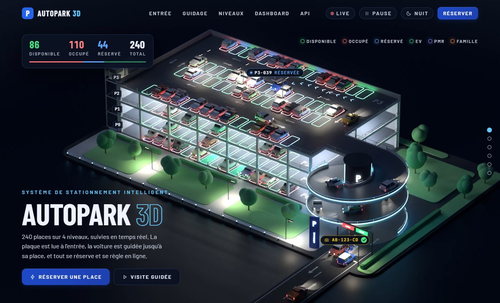
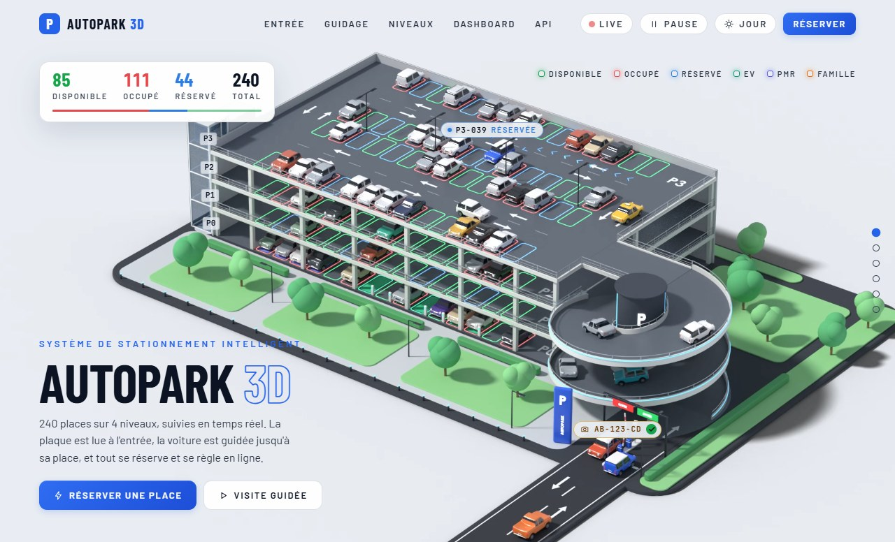
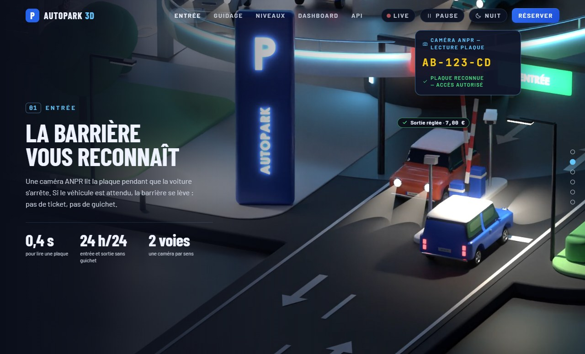
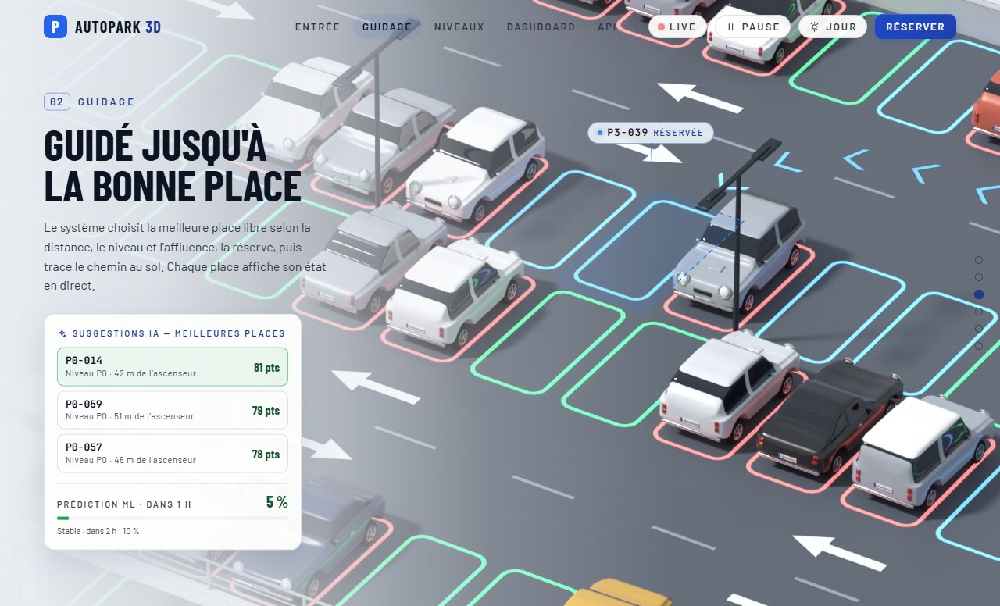
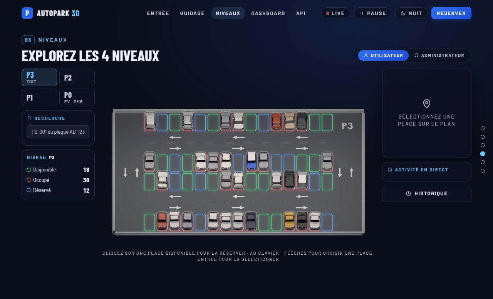
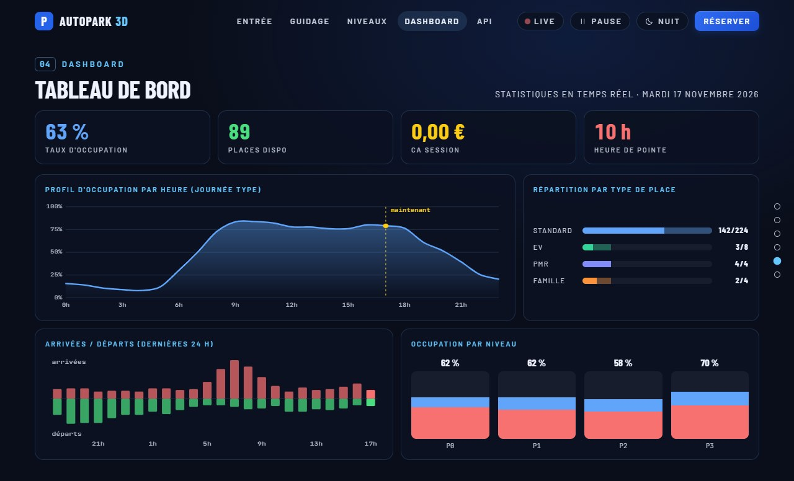
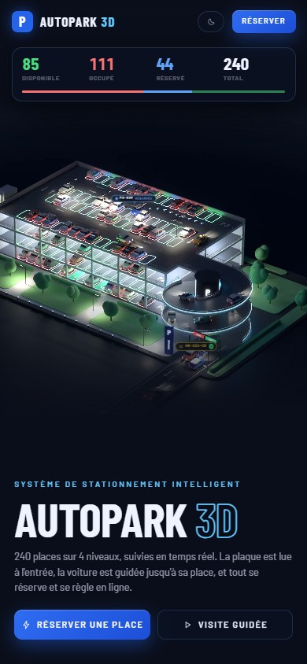

# AutoPark 3D — système de stationnement intelligent

Site vitrine et démonstrateur d'un parking à 4 niveaux (240 places) : maquette 3D
vivante, lecture de plaque à l'entrée, guidage jusqu'à la place, explorateur des
niveaux où chaque place est cliquable, réservation et paiement simulés, tableau de
bord et API.

C'est la refonte du prototype « Parking 3D » (dossier `3D auto Parking`, WebGL
temps réel) : même structure et mêmes textes, mais la 3D est maintenant **rendue
dans Blender (Cycles, carte graphique)** puis lue sous forme de vidéos en boucle
**à 60 images/s**. Résultat : une qualité de rendu « studio » (lumière indirecte,
ombres douces, halos la nuit) et une lecture fluide sur n'importe quel ordinateur
ou téléphone. L'interface (textes, compteurs, étiquettes, fenêtres) reste en
HTML/CSS/JS et suit la vidéo à l'image près.

La maquette est un parking en activité : une trentaine de véhicules de huit modèles
circulent en même temps, chacun avec son trajet, sa vitesse et sa façon de conduire.
Ils s'arrêtent à la barrière, se suivent sur la rampe, se cèdent le passage, cherchent
leur place, se garent, repartent en marche arrière et rejoignent la sortie, sans jamais
se toucher. La boucle dure 48 s.

| Nuit | Jour |
| --- | --- |
|  |  |
|  |  |

| Explorateur des niveaux | Tableau de bord |
| --- | --- |
|  |  |



## Ce que fait le site

- **Accueil** : la maquette complète, en boucle de 48 s. Citadines, berlines, coupés,
  SUV, pick-up, fourgons et taxis entrent pendant que d'autres sortent : certains
  montent jusqu'au toit et s'y garent, d'autres s'arrêtent au niveau P2 ou se garent en
  façade des niveaux couverts, un taxi fait le tour du toit pour déposer un client.
  Les compteurs (Disponible / Occupé / Réservé) changent au moment exact où un
  véhicule se gare ou repart ; l'étiquette suit la place réservée P3-039.
- **Entrée** : gros plan sur le portail. La bulle « Caméra ANPR » tape la plaque de
  chaque véhicule au moment du flash (arrêt à la barrière, ou lecture au pas), la
  barrière se lève ; côté sortie, elle s'ouvre devant chaque véhicule.
- **Guidage** : gros plan sur le toit. La place libérée passe au vert, puis au bleu
  (réservée), des chevrons s'allument au sol jusqu'à elle, la voiture bleue se gare, la
  place passe au rouge, pendant que d'autres véhicules manœuvrent autour. Suggestions
  de places notées et prévision d'occupation.
- **Niveaux** : plan 3D de chaque niveau (P0 à P3). Survol = état de la place ;
  clic sur une place libre = réservation (plaque, durée, 3,50 € / h), reçu, compte à
  rebours, « Libérer & payer », historique. Recherche par numéro de place ou par
  plaque. Simulation « live » d'arrivées et de départs. Mode administrateur :
  taux d'occupation, chiffre d'affaires, arrivée / sortie simulées, remise à zéro.
- **Dashboard** : indicateurs et graphiques (profil horaire, types de place,
  arrivées / départs, occupation par niveau).
- **API** : endpoints testables (réponses calculées à partir de l'état du parking),
  journal, webhooks, clés, export JSON / CSV.
- Mode **jour / nuit** (une vidéo par éclairage, bascule sans saut), **visite
  guidée** automatique, défilement section par section, version téléphone.

Tout est une démonstration : rien n'est envoyé sur le réseau, les réservations
restent dans le navigateur (LocalStorage).

## Lancer le site

Prérequis : Node.js 20.19 ou plus récent.

```bash
npm install
```

```bash
npm run dev
```

Puis ouvrir http://localhost:5173

Version de production (dossier `dist/`, fichiers statiques, vidéos comprises) :

```bash
npm run build
```

Aides de mise au point : `?section=1` à `?section=5` ouvre une section,
`?theme=day` ou `?theme=night` force l'éclairage, `?t=9.3` fige la vidéo de la
section à cet instant (utile pour vérifier une étiquette).

## Comment la 3D est fabriquée

Toute la scène est décrite en Python et construite par Blender, sans fichier
externe ni fenêtre (`blender -b`). Blender 5.x requis.

| Étape | Fichier |
| --- | --- |
| Dimensions, couleurs, caméras, boucle | `blender/config.py` |
| Plan d'occupation des 240 places (graine fixe : 89 / 108 / 43) | `blender/layout.py` |
| Gabarits des huit modèles de véhicules | `blender/carspecs.py` |
| La flotte : qui roule, avec quel véhicule, où, comment, à quel moment | `blender/fleet.py` |
| Trajets (chemins, arrêts, manœuvres) et recherche des horaires | `blender/traffic.py` |
| Simulateur de circulation : distances, priorités, attentes | `blender/sim.py` |
| Chemins lissés, vitesses, roues, braquage | `blender/route.py` |
| Décor : socle, bâtiment, rampe hélicoïdale, portail, ascenseur, jardin | `blender/world.py`, `blender/geo.py` |
| Matériaux jour / nuit | `blender/mats.py` |
| Véhicules (carrosseries lissées, roues, plaques) et tout ce qui bouge | `blender/cars.py`, `blender/actors.py`, `blender/anim.py` |
| Caméras, lumières, réglages Cycles | `blender/stage.py`, `blender/camera.py` |
| Rendu | `blender/render.py`, `blender/compose.py`, `blender/render_all.sh` |
| Compléments après rendu | `blender/fix_zones.py`, `blender/rerender_zones.py`, `blender/fix_all.sh` |
| Plans des niveaux pour l'explorateur | `blender/levels.py` |
| Données de synchronisation pour le site | `blender/export_data.py` |

### Un parking vivant qui boucle sans raccord

Chaque véhicule appartient à une « chaîne » (`fleet.py`) : un trajet rejoué toutes les
48 s. Quand le trajet dure plus longtemps (montée jusqu'au toit, stationnement,
descente : jusqu'à 2 min 30), plusieurs véhicules identiques s'y succèdent, décalés d'une
boucle : à la dernière image, le véhicule *k* est exactement là où était le véhicule
*k + 1* à la première (même angle de roues, mêmes feux). Les véhicules très
reconnaissables n'apparaissent qu'une fois : ils arrivent de la route ou d'une allée
couverte et disparaissent hors de vue.

Les chaînes sont cadencées une à une (`traffic.py`). Chaque véhicule suit sa vitesse de
consigne (zones, virages, freinage anticipé avant un arrêt) et regarde devant lui sur
toute la boucle (`sim.py`) : il ralentit derrière un autre, attend qu'une manœuvre se
termine, cède le passage avant de couper une voie. Si son horaire d'arrivée crée un
bouchon ou un frôlement, l'horaire voisin est essayé. Le calcul prend moins d'une minute
et reste en cache (`blender/work/plan_*.json`) tant que les sources ne changent pas.

Les vitesses se raccordent en douceur (accélération continue), le cap est lissé, les
roues roulent sans glisser ; les feux stop s'allument au freinage et, la nuit, les
phares s'éteignent une fois garé. Barrières, flash de la caméra, couleurs des places et
chevrons découlent des mêmes instants.

### Un rendu « fond fixe + zones animées »

La caméra ne bouge pas : l'essentiel de l'image ne change jamais. `render.py`
calcule donc
1. un **fond** une seule fois, avec beaucoup d'échantillons, sans les éléments animés ;
2. pour chaque image, seulement les **zones** où quelque chose bouge (véhicule avec
   son ombre et ses faisceaux de phares, barrière, ascenseur, place qui change de
   couleur), avec flou de mouvement ; une zone dont tout le contenu est identique à une
   zone déjà rendue (véhicule à l'arrêt) est réutilisée ;

puis `compose.py` recolle les zones sur le fond avec un fondu, ajoute le halo des
lumières (nuit) et encode en H.264. Le fond est parfaitement stable (aucun
scintillement) et le rendu est 3 à 5 fois plus rapide qu'en images complètes.

Les matériaux des véhicules sont portés par les maillages : les voitures identiques
sont de vraies instances pour Cycles, et chaque rendu de zone démarre en une demi-seconde. `scripts/check_zones.py` compare une
image assemblée à la même image rendue en entier : l'écart reste au niveau du bruit.

La vue générale est rendue en 2640 × 1440, les deux vues rapprochées en 2200 × 1200.

Le rendu se fait par **morceaux de 240 images**, chacun dans un processus Blender neuf :
dans un seul processus, les données que Cycles garde d'une image à l'autre finissent par
se dérégler (des faisceaux de phares sortaient en cônes noirs après un millier d'images).

Ce découpage a deux limites connues, corrigées après le rendu par deux outils
(`blender/fix_all.sh` les enchaîne pour les vidéos publiées) :

- **La lumière des voitures dépasse leurs zones** : reflets sur le totem brillant, lueur
  des feux arrière sur le sol, ombre d'une voiture hors cadre, lisse de barrière levée
  alors que le fond la montre baissée. Là où le découpage change d'une image à l'autre,
  cette lumière apparaît ou disparaît d'un coup. `scripts/check_steps.py` mesure ces
  sauts ; `blender/fix_zones.py` rend des rectangles fixes en zones supplémentaires dans
  toutes les images où ils ne sont pas déjà couverts.
- **Le premier morceau a un autre grain** : il est rendu dans le processus qui vient de
  rendre le fond à 1 400 échantillons, et Cycles y garde le motif d'échantillonnage du
  fond. Cela donne un léger saut au raccord de boucle, visible surtout sur le toit de
  nuit. `blender/rerender_zones.py` refait ces zones dans un processus neuf.

### Ouvrir la scène dans Blender

Les fichiers `.blend` ne sont pas dans le dépôt : avec la flotte animée (2 880 images),
une scène pèse environ 375 Mo, plus que la limite de GitHub. Cette commande crée
`blender/scenes/hero_night.blend` sans lancer de rendu, avec la maquette complète, son
animation et la caméra de la vue générale ; on peut ensuite l'ouvrir, tourner autour,
lancer un rendu :

```bash
blender -b --factory-startup -P blender/render.py -- --view hero --night --blend
```

### Refaire les rendus

```bash
bash blender/render_all.sh
```

Variantes : `hero_night hero_day gate_night gate_day roof_night roof_day` (on peut
n'en passer qu'une partie : `bash blender/render_all.sh gate_night`). Durées de rendu
mesurées sur une RTX 4060 portable (8 Go) pour la boucle de 48 s : vue générale 5 h 10
(jour) et environ 6 h 30 (nuit) ; entrée 3 h 55 (jour) et 7 h 50 (nuit) ; toit environ
4 h 45 (jour) et 7 h 05 (nuit). Soit environ 35 h pour les six vidéos, plus 15 min à
1 h 30 d'assemblage par vidéo. Le rendu reprend là où il s'est arrêté s'il est
interrompu.

Un seul rendu à la fois : un processus de rendu occupe environ 7 Go de mémoire vive, et
un jeu ou un autre rendu sur la même carte graphique le fait échouer.

Les vidéos publiées ont ensuite reçu leurs compléments de zones (45 min à 2 h par vue),
puis ont été assemblées de nouveau. Il faut pour cela garder les zones (environ 115 Go
pour les six vues) :

```bash
KEEP_ZONES=1 bash blender/render_all.sh
```

```bash
bash blender/fix_all.sh
```

Une image de contrôle complète :

```bash
blender -b --factory-startup -P blender/render.py -- --view hero --night --still --frame 556
```

Plans des niveaux (processeur, environ 10 min) et données du site :

```bash
blender -b --factory-startup -P blender/levels.py
```

```bash
blender -b --factory-startup -P blender/export_data.py
```

Ne change pas l'animation entre deux variantes d'une même vue : les vidéos jour
et nuit doivent rester image pour image identiques pour que la bascule soit invisible.

## Contrôles

| Contrôle | Commande |
| --- | --- |
| Horaires de la flotte, écarts entre véhicules | `python blender/traffic.py` (Python de Blender) |
| Collisions, dégagements, barrières levées, entrées et sorties hors cadre | `python scripts/check_route.py` |
| Aperçu de la circulation vue de dessus (vidéo en une minute) | `python scripts/topview.py` |
| Raccord de boucle ; apparitions et disparitions hors de vue | `blender -b --factory-startup -P scripts/check_seam.py` |
| Planche des huit modèles de véhicules | `blender -b --factory-startup -P scripts/lineup.py` |
| Rendu par zones identique à une image complète | `python scripts/check_zones.py <dossier> <image>` |
| Sauts de lumière là où le découpage en zones change | `python scripts/check_steps.py gate_night` |
| Cadrage : où tombent les points clés dans la maquette | `python scripts/frame_probe.py hero gate roof` |
| Captures du site (Chrome sans fenêtre) | `node scripts/shot.mjs` |
| Parcours complet : réservation, reçu, sortie, API | `node scripts/flow.mjs` |

Les scripts Node utilisent `puppeteer-core` : l'installer dans un dossier temporaire
(`npm i puppeteer-core@24`) et y copier le script.

## Structure du site

| Élément | Fichier |
| --- | --- |
| Orchestration, thème, sections, visite guidée | `src/main.js` |
| Vidéos 3D par éclairage, bascule synchronisée | `src/ui/videoScene.js` |
| Étiquettes calées sur la vidéo (compteurs, bulle ANPR, place suivie) | `src/ui/overlays.js` + `src/data/sync.json` |
| Défilement section par section | `src/ui/sections.js` |
| Explorateur des niveaux (canvas) | `src/ui/explorer.js` + `public/img/levels/` |
| Réservation, reçu, sortie, historique | `src/ui/booking.js` |
| Tableau de bord, API simulée | `src/ui/dashboard.js`, `src/ui/api.js` |
| État du parking, simulation, LocalStorage | `src/core/store.js` + `src/data/layout.json` |
| Styles | `src/styles/` (unité `--u` : la maquette fait 1280 × 776) |

## Personnaliser

- **Textes** : `index.html`
- **Couleurs de l'interface** : `src/styles/base.css` (`:root`, thèmes nuit et jour)
- **Scène 3D** (dimensions, couleurs, caméras) : `blender/config.py`, puis refaire
  les rendus et `export_data.py`
- **Tarif** : `rate` dans `blender/export_data.py` (repris dans `src/data/layout.json`)
