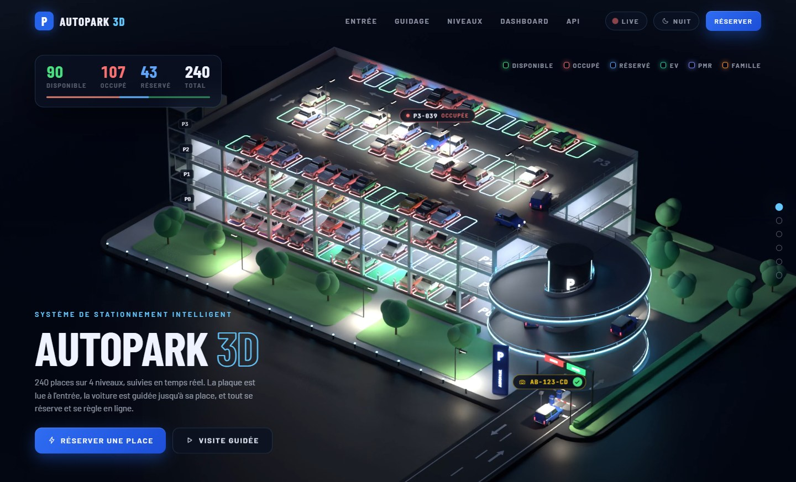
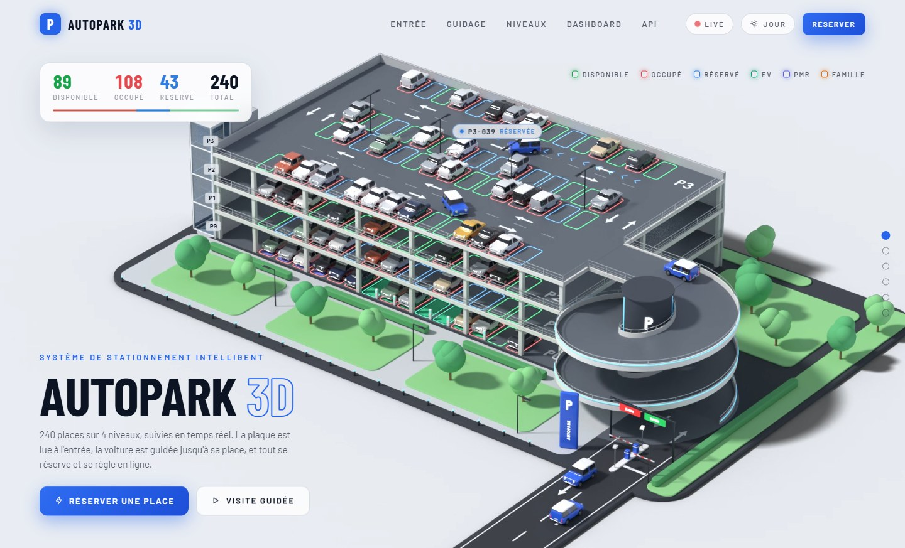
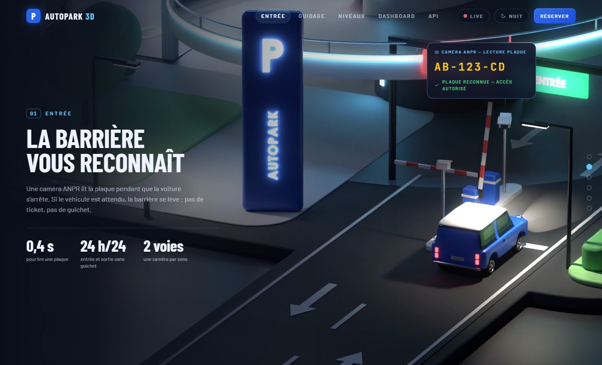
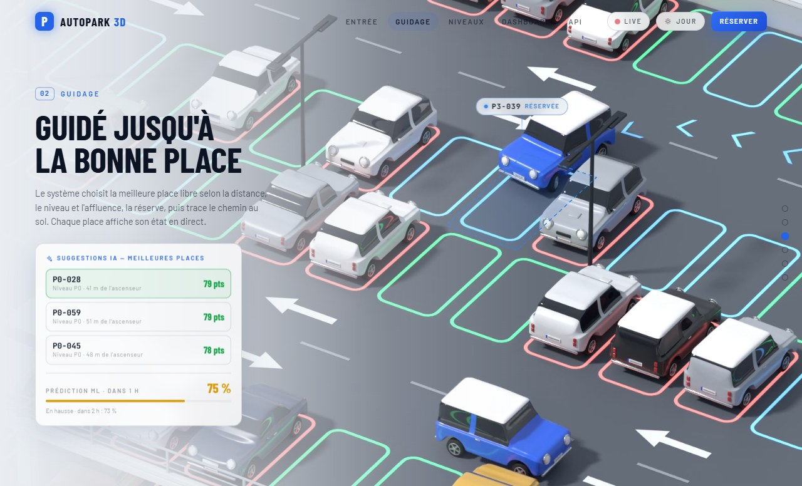
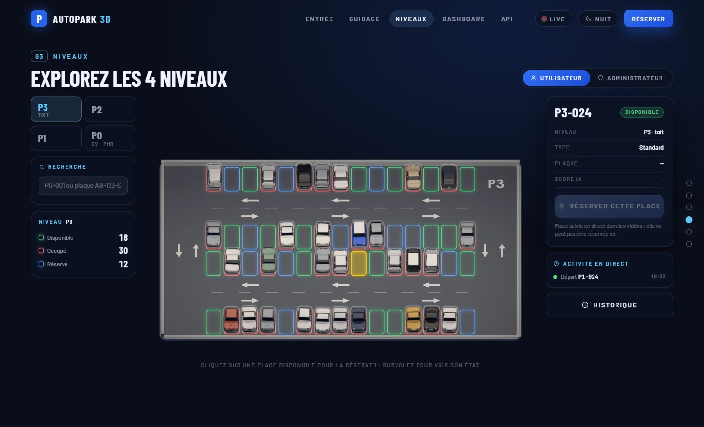
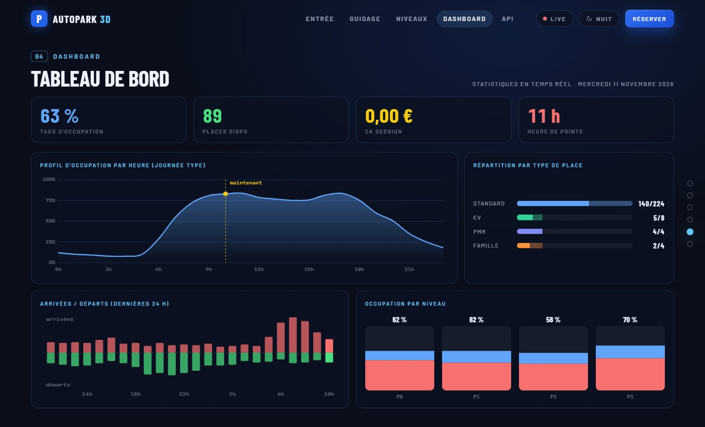
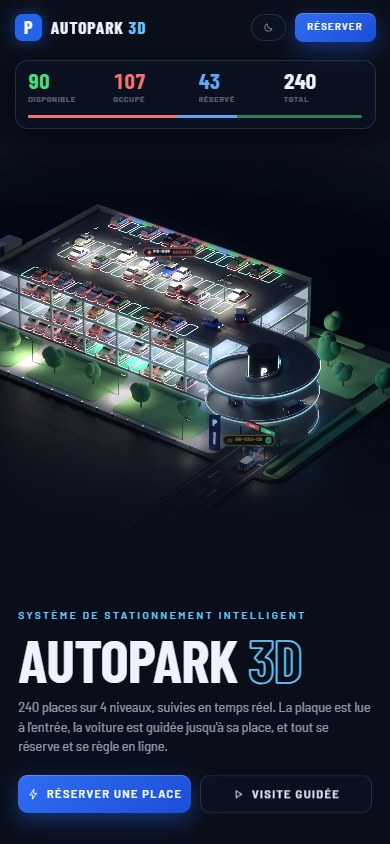

# AutoPark 3D — système de stationnement intelligent

Site vitrine et démonstrateur d'un parking à 4 niveaux (240 places) : maquette 3D
vivante, lecture de plaque à l'entrée, guidage jusqu'à la place, explorateur des
niveaux où chaque place est cliquable, réservation et paiement simulés, tableau de
bord et API.

https://pdha8.github.io/autopark-3d/
C'est la refonte du prototype « Parking 3D » (dossier `3D auto Parking`, WebGL
temps réel) : même structure et mêmes textes, mais la 3D est maintenant **rendue
dans Blender (Cycles, carte graphique)** puis lue sous forme de vidéos en boucle
**à 60 images/s**. Résultat : une qualité de rendu « studio » (lumière indirecte,
ombres douces, halos la nuit) et une lecture fluide sur n'importe quel ordinateur
ou téléphone. L'interface (textes, compteurs, étiquettes, fenêtres) reste en
HTML/CSS/JS et suit la vidéo à l'image près.

| Nuit | Jour |
| --- | --- |
|  |  |
|  |  |

| Explorateur des niveaux | Tableau de bord |
| --- | --- |
|  |  |



## Ce que fait le site

- **Accueil** : la maquette complète en boucle de 12 s. Sept voitures bleues se
  relaient sur un même trajet : route d'accès, arrêt à la barrière, rampe en spirale,
  toit, place réservée, puis retour par la voie intérieure de la rampe et sortie.
  Les compteurs (Disponible / Occupé / Réservé) et l'étiquette de la place suivie
  changent au moment exact où la voiture se gare ou repart.
- **Entrée** : gros plan sur le portail. La bulle « Caméra ANPR » tape la plaque au
  moment du flash, la barrière se lève ; côté sortie, la barrière s'ouvre toute seule.
- **Guidage** : gros plan sur le toit. La place libérée passe au vert, puis au bleu
  (réservée), des chevrons s'allument au sol jusqu'à elle, la voiture se gare, la
  place passe au rouge. Suggestions de places notées et prévision d'occupation.
- **Niveaux** : plan 3D de chaque niveau (P0 à P3). Survol = état de la place ;
  clic sur une place libre = réservation (plaque, durée, 3,50 € / h), reçu, compte à
  rebours, « Libérer & payer », historique. Recherche par numéro de place ou par
  plaque. Simulation « live » d'arrivées et de départs. Mode administrateur :
  taux d'occupation, chiffre d'affaires, arrivée / sortie simulées, remise à zéro.
- **Dashboard** : indicateurs et graphiques (profil horaire, types de place,
  arrivées / départs, occupation par niveau).
- **API** : endpoints testables (réponses calculées à partir de l'état du parking),
  journal, webhooks, clés, export JSON / CSV.
- Mode **jour / nuit** (une vidéo par éclairage, bascule sans saut), **visite
  guidée** automatique, défilement section par section, version téléphone.

Tout est une démonstration : rien n'est envoyé sur le réseau, les réservations
restent dans le navigateur (LocalStorage).

## Lancer le site

Prérequis : Node.js 20.19 ou plus récent.

```bash
npm install
```

```bash
npm run dev
```

Puis ouvrir http://localhost:5173

Version de production (dossier `dist/`, fichiers statiques, vidéos comprises) :

```bash
npm run build
```

Aides de mise au point : `?section=1` à `?section=5` ouvre une section,
`?theme=day` ou `?theme=night` force l'éclairage, `?t=9.3` fige la vidéo de la
section à cet instant (utile pour vérifier une étiquette).

## Comment la 3D est fabriquée

Toute la scène est décrite en Python et construite par Blender, sans fichier
externe ni fenêtre (`blender -b`). Blender 5.x requis.

| Étape | Fichier |
| --- | --- |
| Dimensions, couleurs, caméras, boucle | `blender/config.py` |
| Plan d'occupation des 240 places (graine fixe : 89 / 108 / 43) | `blender/layout.py` |
| Trajet des voitures : chemin lissé, vitesses, roues, braquage | `blender/route.py` |
| Décor : socle, bâtiment, rampe hélicoïdale, portail, ascenseur, jardin | `blender/world.py`, `blender/geo.py` |
| Matériaux jour / nuit | `blender/mats.py` |
| Voitures (carrosseries lissées, roues, plaques) et tout ce qui bouge | `blender/cars.py`, `blender/actors.py`, `blender/anim.py` |
| Caméras, lumières, réglages Cycles | `blender/stage.py`, `blender/camera.py` |
| Rendu | `blender/render.py`, `blender/compose.py`, `blender/render_all.sh` |
| Plans des niveaux pour l'explorateur | `blender/levels.py` |
| Données de synchronisation pour le site | `blender/export_data.py` |

### Une animation qui boucle sans raccord

Chaque pose est une fonction du temps. Les sept voitures « héros » sont
identiques et suivent la même route, décalées d'une boucle (12 s) : à la dernière
image, la voiture *k* est exactement là où était la voiture *k + 1* à la première
(même angle de roues, même braquage). Barrières, ascenseur, couleurs des places et
chevrons ont une période de 12 s. Les vitesses se raccordent en douceur
(accélération continue), le cap est lissé, les roues roulent sans glisser.

### Un rendu « fond fixe + zones animées »

La caméra ne bouge pas : l'essentiel de l'image ne change jamais. `render.py`
calcule donc
1. un **fond** une seule fois, avec beaucoup d'échantillons, sans les éléments animés ;
2. pour chaque image, seulement les **zones** où quelque chose bouge (voiture avec
   son ombre et ses faisceaux de phares, barrière, ascenseur, place qui change de
   couleur), avec flou de mouvement ;

puis `compose.py` recolle les zones sur le fond avec un fondu, ajoute le halo des
lumières (nuit) et encode en H.264. Le fond est parfaitement stable (aucun
scintillement), les fichiers sont légers (4 à 8 Mo pour 12 s) et le rendu est 3 à
5 fois plus rapide qu'en images complètes. `scripts/check_zones.py` compare une
image assemblée à la même image rendue en entier : l'écart reste au niveau du bruit.

La vue générale est rendue en 2640 × 1440, les deux vues rapprochées en 2200 × 1200.

### Ouvrir la scène dans Blender

`blender/scenes/hero_day.blend` et `hero_night.blend` contiennent la maquette
complète avec son animation (720 images) et la caméra de la vue générale : on peut
les ouvrir, tourner autour, lancer un rendu. Pour les régénérer après une
modification (sans rendu, quelques secondes) :

```bash
blender -b --factory-startup -P blender/render.py -- --view hero --night --blend
```

### Refaire les rendus

```bash
bash blender/render_all.sh
```

Variantes : `hero_night hero_day gate_night gate_day roof_night roof_day` (on peut
n'en passer qu'une partie : `bash blender/render_all.sh gate_night`). Durées
mesurées sur une RTX 4060 portable, assemblage compris : vue générale 1 h 10 (nuit)
et 35 min (jour) ; entrée 1 h 05 (nuit) ; toit 45 min (nuit) ; 35 à 45 min pour les
vues rapprochées de jour. Soit environ 5 h pour les six vidéos. Le rendu reprend là
où il s'est arrêté s'il est interrompu.

Une image de contrôle complète :

```bash
blender -b --factory-startup -P blender/render.py -- --view hero --night --still --frame 556
```

Plans des niveaux (processeur, environ 10 min) et données du site :

```bash
blender -b --factory-startup -P blender/levels.py
```

```bash
blender -b --factory-startup -P blender/export_data.py
```

Ne change pas l'animation entre deux variantes d'une même vue : les vidéos jour
et nuit doivent rester image pour image identiques pour que la bascule soit invisible.

## Contrôles

| Contrôle | Commande |
| --- | --- |
| Collisions, dégagements, voitures cachées hors cadre | `python scripts/check_route.py` (Python de Blender) |
| Raccord de boucle sur la scène construite | `blender -b --factory-startup -P scripts/check_seam.py` |
| Rendu par zones identique à une image complète | `python scripts/check_zones.py <dossier> <image>` |
| Cadrage : où tombent les points clés dans la maquette | `python scripts/frame_probe.py hero gate roof` |
| Captures du site (Chrome sans fenêtre) | `node scripts/shot.mjs` |
| Parcours complet : réservation, reçu, sortie, API | `node scripts/flow.mjs` |

Les scripts Node utilisent `puppeteer-core` : l'installer dans un dossier temporaire
(`npm i puppeteer-core@24`) et y copier le script.

## Structure du site

| Élément | Fichier |
| --- | --- |
| Orchestration, thème, sections, visite guidée | `src/main.js` |
| Vidéos 3D par éclairage, bascule synchronisée | `src/ui/videoScene.js` |
| Étiquettes calées sur la vidéo (compteurs, bulle ANPR, place suivie) | `src/ui/overlays.js` + `src/data/sync.json` |
| Défilement section par section | `src/ui/sections.js` |
| Explorateur des niveaux (canvas) | `src/ui/explorer.js` + `public/img/levels/` |
| Réservation, reçu, sortie, historique | `src/ui/booking.js` |
| Tableau de bord, API simulée | `src/ui/dashboard.js`, `src/ui/api.js` |
| État du parking, simulation, LocalStorage | `src/core/store.js` + `src/data/layout.json` |
| Styles | `src/styles/` (unité `--u` : la maquette fait 1280 × 776) |

## Personnaliser

- **Textes** : `index.html`
- **Couleurs de l'interface** : `src/styles/base.css` (`:root`, thèmes nuit et jour)
- **Scène 3D** (dimensions, couleurs, caméras) : `blender/config.py`, puis refaire
  les rendus et `export_data.py`
- **Tarif** : `rate` dans `blender/export_data.py` (repris dans `src/data/layout.json`)
